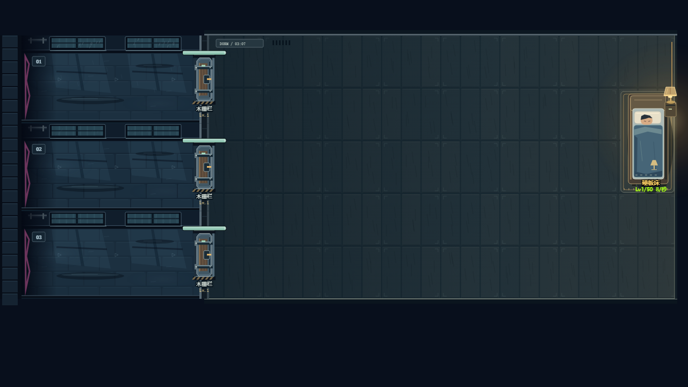
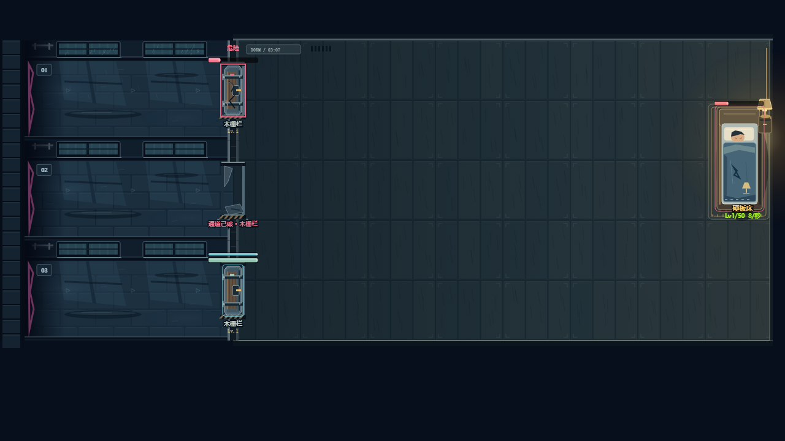
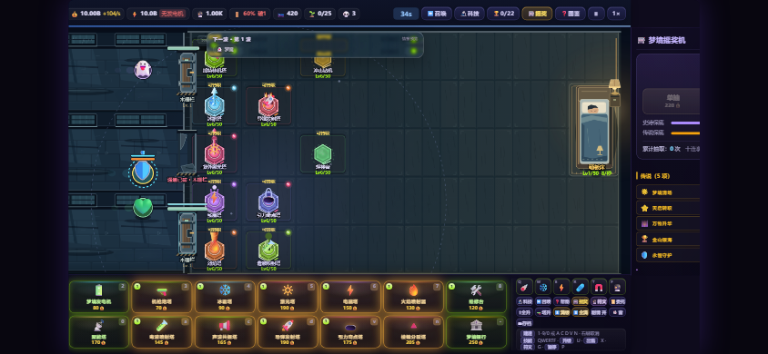

# 雨夜宿舍视觉规范

本阶段采用原创 Canvas 矢量程序化美术，源码 `scene-art.js`；无需运行时外部图片。用户已指定方向并授权自行选择，本轮以实际游戏原生截图为场景样板。全套建筑、梦魇及 UI 将在后续沿用此规范，现有角色图形不算本轮重制完成。

## 画面与材质

- 原生 1280×720，正交俯视。宿舍格子 110×98，三走廊共享原碰撞区域；门洞 80 高、中心 x380；床占第 8 列的两格。美术不移动交互或碰撞。
- 夜色 `#080f1c`，走廊石砖 `#182a39`，宿舍木地板 `#22323a`，金属亮边 `#a0adb0`，暖灯 `#eab96a`，危险 `#eb6685`。敌人沿用紫红识别色，场景不铺大面积同色光效。
- 石材用交错砖缝、磨损与低频积水；木材用窄板接缝和短木纹；金属用倒角、横梁、铰链与亮暗双边；布料用折线、包边和缝线。主体轮廓强于微小纹理，禁止用 Emoji 充当场景对象。
- 雨窗的投影落在走廊地面；暖金光来自应急床头灯，床侧有供电线、开关、床头柜。圆角保留给寝具，门体为硬边钢结构，早期木门保留木芯。床被采用蓝灰布料和缝制灯图案。

## 动画、层级与预算

背景及全部固定材质只烘焙一次到离屏 Canvas；一张 1280×720 底图、256² 暖灯贴片、128² 雾贴片，共 4,014,080 字节像素数据。固定原生画布不随 CSS 视口缩放重复生成。雨线成批绘制；雾气、呼吸光和被面仅作低幅度位移。没有随机纹理每帧重建。

背景、雨影和暖光先于建筑/敌人；门上生命/盾量、破门口、低血量危险字和红框保持清楚。门根据实际 HP 显示凹痕、裂纹、倒落钢片；观察到实际回血时显示焊接，床显示补缀。观察状态放在 WeakMap，不写入存档或模拟实体。降低动态时雨影、雾气、灯光与被面保持静止，危险提醒仍显示。

美术使用确定性哈希与渲染时钟；render.js 的震屏、电弧也改用独立视觉噪声。`Math.random` 在原生 Canvas 回归中替换为抛错函数，场景及完整渲染仍通过，确保画帧次数不推进战斗随机数。

## 样板与验证

`node tests/scene-art.test.js` 在真实 Chromium153 Canvas 内核中检查：60 帧不改资源/科技/生命/敌人/战斗统计、缓存仅构建一次、像素缓存小于 4.1MB、雨雾灯光动画确实变化、降低动态保持稳定。另输出修复与混合建筑截图。人工式图像检查已在原生尺寸及缩小视口执行；本样板由代理按用户委托选定，非用户手动签字。

尚未完成：16 建筑和32转职新外观、35怪物与五 Boss 重绘、UI 统一，以及物理手机画质与帧率验收。缓存节省绘制提交，不代表最终 FPS 达标。来源与许可见 `assets/art/manifest.json`。
