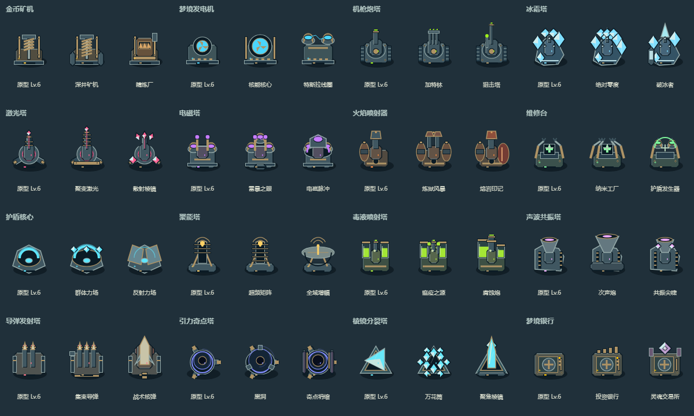
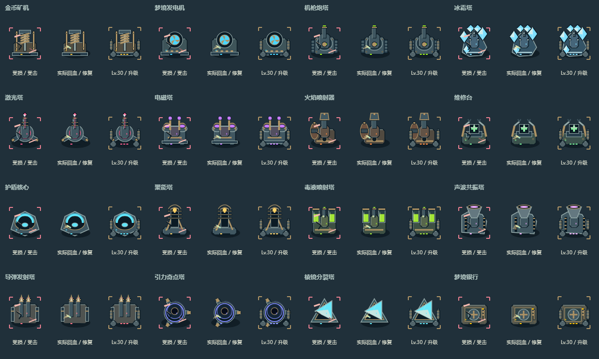
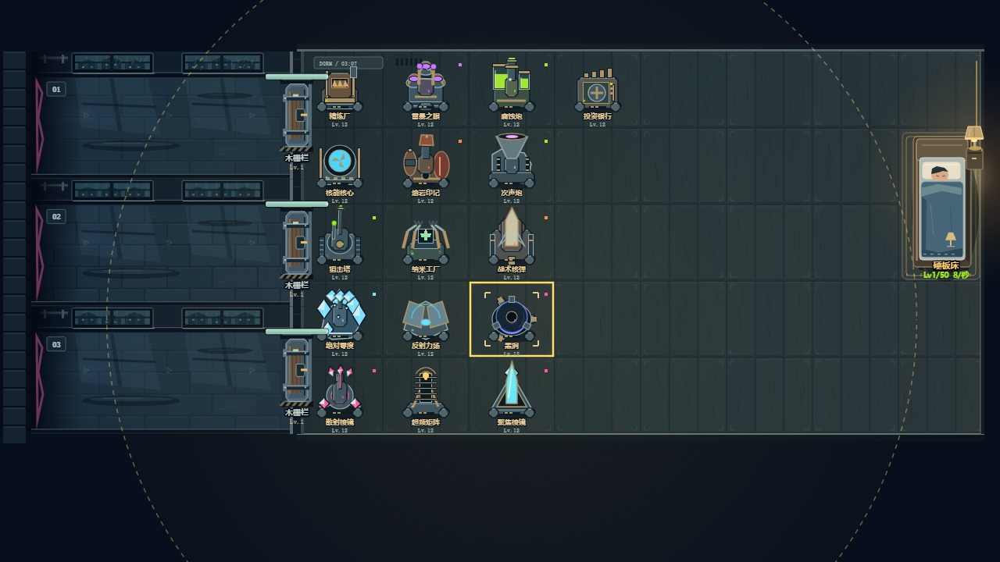

# 建筑美术家族（已接入，完整战斗平衡仍开发中）

`building-art.js` 替换旧六边底座叠 Emoji。16 原型与 32 转职使用原创 Canvas 机械结构，保留原格子、碰撞、费用、射程和战斗规则。钢灰主体、黄铜连接件、深色投影、小面积属性色灯光沿用雨夜场景规范。用户已委托自行选择方向；本样板由代理按原生尺度与战场截图核验。

| 建筑 | A 分支结构 | B 分支结构 |
|---|---|---|
| 矿机：立柱、钻杆、螺旋钻头 | 深井钻机双侧支撑及长钻头 | 精炼炉、观察窗、排气管 |
| 发电机：转子与散热机组 | 大型核能转子和护栏 | 双特斯拉线圈 |
| 机枪：履带、转塔、炮管 | 三管加特林 | 长狙击管和瞄准镜 |
| 冰霜：冷却甲与冰晶 | 环形多晶冠 | 中心长冰矛和冷却模块 |
| 激光：三脚支座和聚焦导轨 | 加长四环聚能轨 | 三枚扇形散射镜 |
| 电磁：双线圈和铜导线 | 第三大型线圈 | 前向脉冲板 |
| 火焰：燃料罐、阀门、喷口 | 双喷口双储罐 | 加压红罐和宽喷嘴 |
| 维修：工作台、机械臂 | 四臂纳米修复台 | 双电容与护盾弧罩 |
| 护盾：碟形投影器 | 宽罩与三晶体发射器 | 双角反射面板 |
| 聚能：立式天线与线栅 | 五层超频散热片 | 横向大碟形天线 |
| 毒液：储液瓶、管路、喷头 | 多储罐、分叉喷头 | 加压大罐、宽口腐蚀炮 |
| 声波：音箱、栅格、号角 | 宽口次声喇叭 | 共振晶体和窄口号角 |
| 导弹：装甲发射舱 | 三列集束弹舱 | 单枚大型战术弹与尾翼 |
| 引力：三脚支撑和环形核心 | 大型三臂黑洞环 | 双侧约束轨与浓缩内核 |
| 棱镜：三角光学支架 | 六枚环形棱镜 | 长条聚焦晶体 |
| 银行：金库、铰链、轮锁 | 顶部投资金条 | 灵魂晶体和双存储柱 |

## 动画与真实状态

每种均有待机机构或巡视、工作灯、实际受击闪痕、低血量裂纹/危险角标、实际回血焊接、升级/转职描边、选中角标及建造实体预览。Lv12 增加支脚装甲，Lv30 增加侧板及散热件。攻击建筑由实际 fireFx/recoil/flameOn/gravOn 和放电事件驱动；生产和服务建筑显示钻杆/转子/机械臂/投影器等工作状态，不伪装成炮塔攻击。

机枪弹壳与后坐、冰晶碎片、激光灼痕、电磁电弧、火焰余烬、毒蚀与真实毒层、导弹尾焰/爆环、引力收缩弧、声波环、棱镜碎光均已接入。持续武器的命中反馈跟随合并伤害提示，不逐模拟帧刷特效。新 impact 事件在现有 effects 达到 96 时省略装饰，伤害照常结算；该限额不改现有攻击光束/技能逻辑。降低动态时装饰机构停止，信息性受击/修复反馈保留。

射程由当前 bstat 的 range 或发电机转职 zapRange 绘制，纯产出建筑没有虚构攻击圈。战场生命与盾量条独立于材质层，控制异常用文字标示；高等级也始终显示实际转职名称，原有等级风味名保留在详情入口。共鸣使用少量真实 resN 晶体指示，移除每座炮塔的大范围常驻光雾。

## 缓存、测试与限制

底盘 80²、武器头 96² 分别缓存，武器头旋转及后坐复用纹理。LRU 上限 144 个组件，理论像素上限 5,308,416 字节；本次联系表缓存 3,153,920 字节，16 建筑实战视图 3,563,520 字节，连续 30 帧新增构建 0。观察用 WeakMap，不写入存档或游戏数值。

`node tests/building-art.test.js` 在 Chromium153 原生 Canvas 中检查全部 48 外观差异、可见且无边缘裁剪、16 家族的动画与降低动态、所有选中/真实范围和三个等级结构；实际渲染全部 16 建筑连续 60 帧不改资源/血量/冷却/符文/敌人/战斗统计，并在 Math.random 抛错时仍能绘制。联系表为明确设定姿态的素材核验，实战图通过实际建造接口生成测试阵容，不作为合法运营通关证明。

`tests/visual-events.test.js` 检查 11 类攻击来源的真实命中与无伤害时不伪造命中、持续伤害节流、装饰限额不阻挡伤害，以及开启/关闭新 impact 后 240 个真实模拟步的战斗、经济、AI 和随机调用完全一致。生成来源见 `assets/art/buildings.json`；生产代码没有外部位图依赖。

仍需完成：32 分支的全面成本收益平衡、持续武器减益/抗性及全共鸣组合审计；35 梦魇、五 Boss 与完整 UI 新美术；物理手机与画质/性能验收。旧粒子创建仍与模拟共享 RNG，当前测试只证明本轮绘制及新增 impact 的隔离，不声称所有画质设置已实现。
