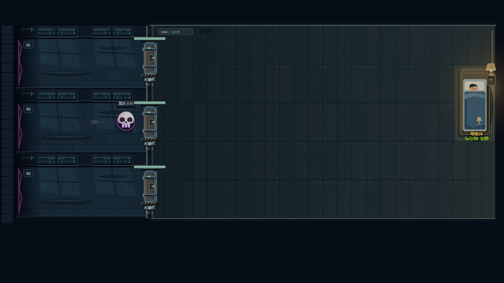

# 敌人行为与反制（继续开发）

数据有 35 个非 Boss 类型；5 个 Boss 由 BOSS_DEFS 独立定义，ENEMY_DEFS 中的通用 boss 条目不是第 36 个普通怪。没有删除任一类型。

`tests/enemies.test.js` 当前 100 项断言：35 类型真实移动、全部 35 普通怪及5 Boss 在眩晕时不继续近身攻击/寄生吸取；时间冻结、EMP/霜噬/治疗的控制反制；连续武器冻缓；真实复苏、资源防重复、数量/时限与读档恢复。它不证明所有敌人特殊能力均已验收。

## 已复现并修复

原来 stun 只令速度为 0，贴住目标后仍会攻击，EMP、霜噬、治疗、召唤和寄生也继续运转。现在控制期间停止主动攻击/主动能力，持续伤害与被动恢复照常推进；有明确的冻结或眩晕窗口可供反制。霜噬原先对火焰/引力的持续输出无效，现在这两类接触伤害和引力拉扯也按 40% 速率减缓。冻缓不是完全停火，界面用“霜缓/冻缓”区分全局时间冻结。

死灵原来每7秒无条件生成随机 grunt/swarm，却称“复活”。新的 enemy-actions.js 从实际死亡的普通敌人记录残骸：

- 残骸保留12秒、最多64个，每波清空。Boss、召唤物、死灵本身、已复苏单位不留下可复苏残骸。
- 每7秒尝试同路210范围内最近至多3具，有0.85秒连线/进度预警；没有残骸就不凭空生怪。
- 眩晕、时间冻结、击杀施法者或停止召唤效果可打断。没有跨局定时器，暂停由模拟时钟自然停住。
- 复苏原对象及原类型/属性，上限生命保持原唯一结算值，当前生命为45%，不再次乘波次/难度/词缀。与其他召唤共用每波120次及在场200时停止接纳的入口。
- 每具只能复苏一次；再次击败不重复给金币、灵魂、符文及击杀型剧情掉落。实际击杀统计照常记录。旧伤害状态和目标清理，不能一具残骸无限循环刷资源。
- 预约使用数字token，调试状态保持可JSON序列化；存档仍重启当前波，不保存尸体或施法引用，新格式版本无需变更。

`tests/enemy-actions.browser.test.js` 在844×390 Chromium触控仿真中显示真实施法预警，实际轻触W时间冻结按钮打断，再检查原重甲单位确实复苏。无剧情视频请求、无循环错误。原生截图与 validation.json 在 Actions 的 artifacts/enemies；这是受控机制场景，不是物理手机或合法运营通关。

仍未完成：全部35种特殊行为/施法前摇与反制组合、10词缀组合平衡、AI目标选择、普通怪新轮廓/动作/死亡及五Boss独立机制/美术。当前普通敌人仍是旧图形，残骸和预警标记不能冒充35怪物重绘。全部共鸣/元素、持续武器全局射速和毒伤抗性也继续审计。
