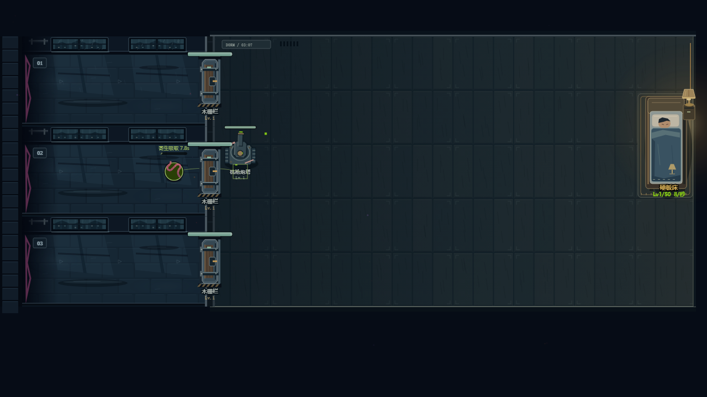

# 敌人行为与反制（继续开发）

数据有 35 个非 Boss 类型；5 个 Boss 由 BOSS_DEFS 独立定义，ENEMY_DEFS 中的通用 boss 条目不是第 36 个普通怪。没有删除任一类型。

`tests/enemies.test.js` 当前 100 项断言：35 类型真实移动、全部 35 普通怪及5 Boss 在眩晕时不继续近身攻击/寄生吸取；时间冻结、EMP/霜噬/治疗的控制反制；连续武器冻缓；真实复苏、资源防重复、数量/时限与读档恢复。它不证明所有敌人特殊能力均已验收。

## 已复现并修复

原来 stun 只令速度为 0，贴住目标后仍会攻击，EMP、霜噬、治疗、召唤和寄生也继续运转。现在控制期间停止主动攻击/主动能力，持续伤害与被动恢复照常推进；有明确的冻结或眩晕窗口可供反制。霜噬原先对火焰/引力的持续输出无效，现在这两类接触伤害和引力拉扯也按 40% 速率减缓。冻缓不是完全停火，界面用“霜缓/冻缓”区分全局时间冻结。

死灵原来每7秒无条件生成随机 grunt/swarm，却称“复活”。新的 enemy-actions.js 从实际死亡的普通敌人记录残骸：

- 残骸保留12秒、最多64个，每波清空。Boss、召唤物、死灵本身、已复苏单位不留下可复苏残骸。
- 每7秒尝试同路210范围内最近至多3具，有0.85秒连线/进度预警；没有残骸就不凭空生怪。
- 眩晕、时间冻结、击杀施法者或停止召唤效果可打断。没有跨局定时器，暂停由模拟时钟自然停住。
- 复苏原对象及原类型/属性，上限生命保持原唯一结算值，当前生命为45%，不再次乘波次/难度/词缀。与其他召唤共用每波120次及在场200时停止接纳的入口。
- 每具只能复苏一次；再次击败不重复给金币、灵魂、符文及击杀型剧情掉落。实际击杀统计照常记录。旧伤害状态和目标清理，不能一具残骸无限循环刷资源。
- 预约使用数字token，调试状态保持可JSON序列化；存档仍重启当前波，不保存尸体或施法引用，新格式版本无需变更。

`tests/enemy-actions.browser.test.js` 在844×390 Chromium触控仿真中显示真实施法预警，实际轻触W时间冻结按钮打断，再检查原重甲单位确实复苏。无剧情视频请求、无循环错误。原生截图与 validation.json 在 Actions 的 artifacts/enemies；这是受控机制场景，不是物理手机或合法运营通关。

## 第二轮真实结算与目标核验

`tests/enemy-abilities.test.js` 新增155项。先运行旧代码，复现23个行为断言失败，再修改真实AI和伤害入口。当前Node合计2207项；新增测试已进入npm test及Actions。

- 吸血本体的40%原先没有复制到实体，实际不吸血；现在按减伤后真实吸收的盾/生命回复。35%词缀保留更强的本体能力；管理员免疫、过量伤害均不提供虚假治疗。
- 寄生原先忽略dur且无限距离连线，同时走路/近战，按名义伤害回血。现在260范围选炮塔，0.6秒蓄力后原地引导最多8秒，只有实际损伤的一半转化为生命；眩晕、时间冻结、距离拉开或建筑移除打断，3秒后重新准备。三种模拟步长验证完整一次吸取总量一致。
- 狂暴本体的1.9倍攻击、五Boss配置的阶段攻击倍率原先未用。现在门、建筑和床都走同一攻击倍率入口。此修复不替代五个Boss独立机制重制。
- 飞行单位越门后继续攻击床铺；锈蚀怪优先存活武器，武器全灭才选其他建筑；所有单位及时释放已出售/摧毁的目标。重复出售同一对象不会再退款或误删另一建筑。
- 自爆与诅咒覆盖床铺并及时销毁零血建筑。亡语取较强爆炸，不削弱本体；诅咒读取配置DPS，最后不足一帧的余时不额外结算。防线损耗与吸血均排除过量伤害。
- 分裂/召唤、禁召、隐身显形窗口、拟态、钻地/绕门、护盾支援、时空加速、虚无光环移除、反射、适应上限、巨像单段门槛与偷金账本均走真实行为验证。10词缀的45个两两组合验证眩晕有效、可击杀及当次死亡子代数量；这不是所有阵容下的组合平衡验收。
- 复苏、寄生、EMP、霜噬、召唤和治疗的提示读取实际行动计时，不重复叠加旧提示。提示绘制不改状态、不推进模拟随机数。寄生前摇和引导连线已接入真实Canvas，并通过实际触控时间冻结打断和距离打断。

仍未完成：全部35种特殊行为/施法前摇与反制组合的整体平衡、10词缀组合难度、普通怪新轮廓/动作/死亡及五Boss独立机制/美术。当前普通敌人仍是旧图形，残骸和预警标记不能冒充35怪物重绘。全部共鸣/元素、持续武器全局射速和毒伤抗性也继续审计。
