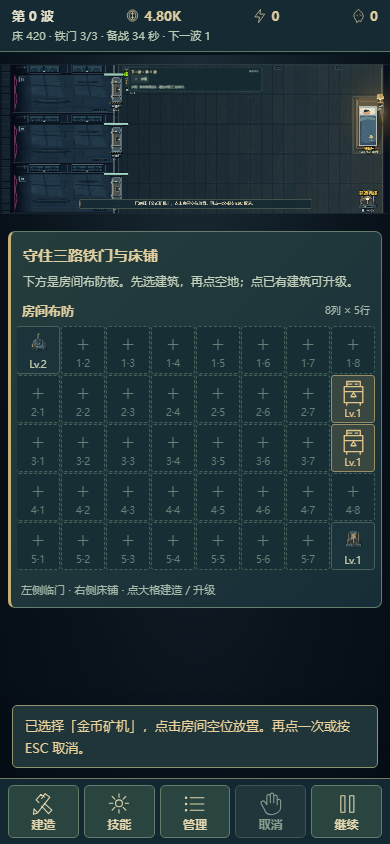
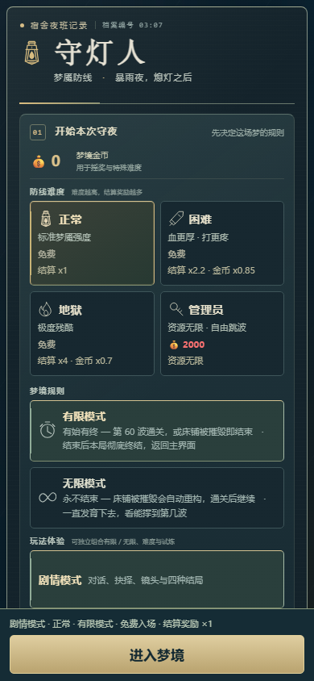
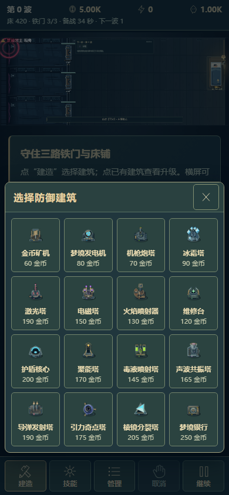
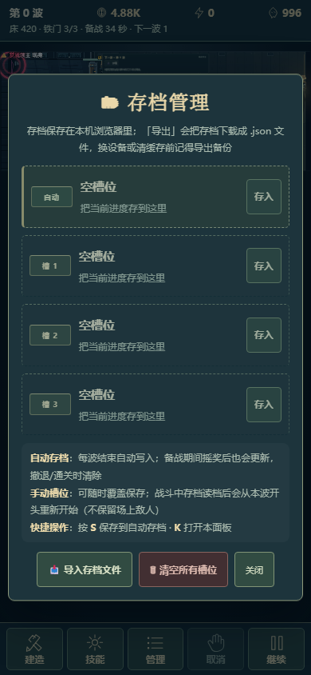
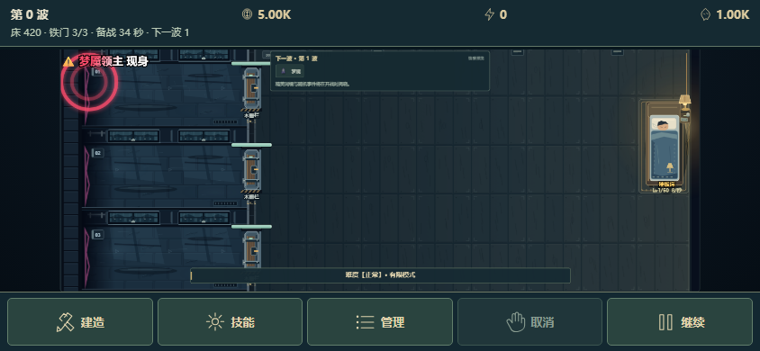

# 手机原生尺寸操作界面

本轮只在本地整合，未提交或上传。实现位于`mobile-controls.js`、`mobile.css`，通过`build.js`内嵌到两份单文件HTML；原版鼠标/键盘与经典画布界面继续可选。

## 实际操作

- 触摸设备短边不大于600 CSS像素时默认启用。主页使用实际屏幕尺寸，难度、玩法、规则和档案可滚动；底部固定“进入梦境/继续梦境”和本局设置摘要。
- 战斗时提供原生字号的资源/威胁栏与“建造、技能、管理、取消、暂停”操作栏，主要点击目标至少44 CSS像素。横屏把更多空间留给战场；竖屏在战场下显示当前选择与点按说明。
- 竖屏增加8列×5行的大格布防板：每格至少44px宽、48px高，直接通过原有命令层建造／选择／升级；显示真实建筑缩略图、等级、床铺和危急状态。320px等窄屏可横向滚动到最右侧，板内纵向滚动适应大字和短屏；上方仍保留完整战场观察三路敌人。横屏收起布防板。
- 手机操作反馈改为原生字号通知。Boss施法名称与倒计时优先显示，冻结技能可实际中断；图鉴关闭按钮、大字说明、音量滑杆与48px剧情选项均有专项回归。
- 建造抽屉提供16张真实建筑缩略图和当前费用；选中后收起抽屉，点原战场格子放置。技能抽屉提供6个技能、说明、冷却和试炼封印状态。
- 管理页提供科技、符文、委托、成就、图鉴、摇奖、存档、床铺/三路门升级、提前召唤、批量升级、速度、剧情/音效、全屏与旋转入口。
- 科技、存档、居民、日记、碎片、剧情与详情保留原控件、事件和数据，只在手机时移动到不受画布缩放影响的层级。符文面板可原生选择目标建筑并镶嵌/卸下，详情也有直接入口。
- 打开操作抽屉不改变玩家暂停；暂停按钮复用原控制与剧情锁定。抽屉约束焦点、屏蔽游戏快捷键、提供遮罩和关闭/Escape入口。
- “使用经典界面”恢复原DOM位置；设备选择独立保存于`tangping_phone_controls`，不进入单局存档。主页的“手机界面”入口或经典操作栏内的同名按钮可随时切回，旋转90度时自动采用原画布兜底。

## 几何与安全区

世界仍为1280×720，网格、碰撞、费用和存档结构不变。手机战斗视图只展示原画布y=66至556的490高战场区域，Canvas元素上移66；事件继续按真实Canvas矩形映射至原世界坐标。普通竖屏/横屏与90度旋转使用各自已有逆变换，不改实体位置。

原生HUD占52像素、底栏66像素，外加共享的`--sat/--sar/--sab/--sal`安全区。战场缩放按剩余可用空间计算，竖屏沿上方排列；非对称左右安全区也参与宽度与中心偏移。竖屏仍建议横屏获得更大的战场。

## 验证

`npm run test:mobile`使用真实Chromium/WebKit页面和触摸事件，覆盖Android仿真的390×844、320×568、844×390、667×375，以及WebKit仿真的390×844。检查原生字号和点击尺寸、五个主要操作、真实点格建造/升级、科技购买、主页与战斗存档、居民/日记/碎片、符文目标/镶嵌/卸下、技能冷却/封印、手动暂停、提前召唤、剧情选项、失败返回/重开、偏好持久化、横竖屏互换及旋转后真实触点。另模拟非对称安全区，断言HUD、战场与底栏互不遮挡。

历史`test:browser`/`test:display`的移动场景显式选择经典模式，保留旧入口回归；新手机模式由独立完整流程覆盖，不用关闭新功能替代新功能验收。原始截图和validation.json位于`artifacts/mobile/`，CI配置也收集该目录。

以上是浏览器仿真，不能代替物理Android/iPhone的全屏、系统手势、真实刘海与GPU性能验收。

真机入口、13项记录表及10秒实际战斗采样已经准备，运行 `npm run device:lab -- --lan`，详见 [DEVICE_TESTING.md](DEVICE_TESTING.md)。新增 `phone-room.browser.test.js` 覆盖390px、320px大字和Windows WebKit的真实触点、一次扣费、右侧滚动、床格保护及同局旋转。

## 实际截图

本轮全部五种初始尺寸流程通过；WebKit与Chromium也在同一局中切换到相反方向后完成真实点按。原生HUD同时显示床铺生命、铁门状态和Boss阶段/生命，危险状态有文字及颜色提示；大字和减少动态选项继续生效。
