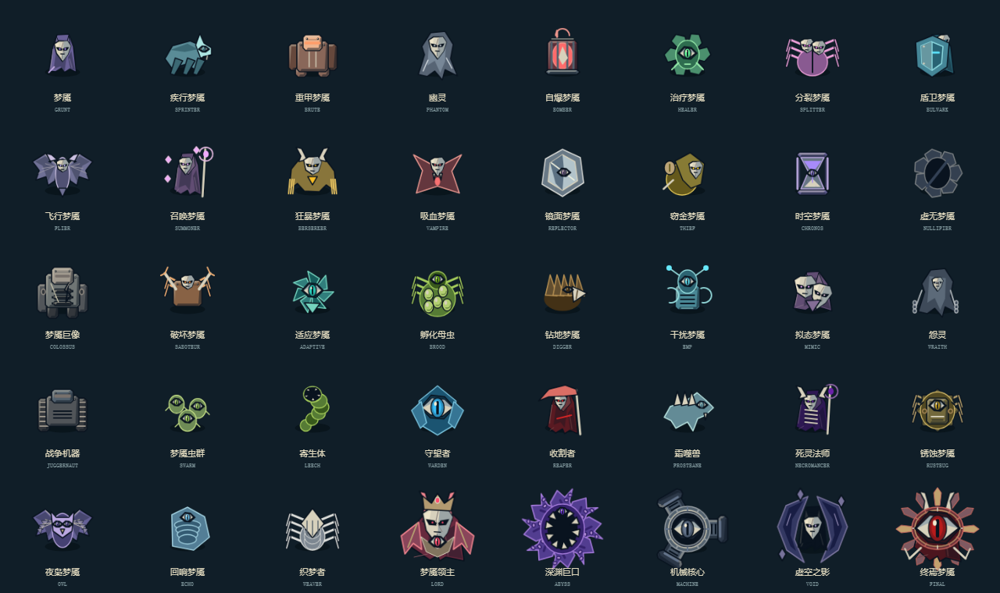

# 场景与梦魇细化

本轮由场景/怪物子代理按用户委托继续完善原创 Canvas 美术。选定样板仍是蓝灰湿石、木地板、倒角金属与暖金灯光；怪物保留原有属性色和清楚的骨白面具/眼部焦点。没有改变世界坐标、碰撞半径、格子、门洞或模拟数值。

## 场景

- 雨窗增加上下凹槽、框架明暗侧、窗扣和玻璃水痕；走廊石砖增加侧边厚度、低对比断裂和不连续湿反射，脚边加入嵌入式排水格栅。
- 宿舍墙沿增加扣件、维护夹板和通风细节；木板加入节疤、端部钉点和更清楚的建造角标，保留格子中央的低频背景，避免压过武器与怪物主体。
- 床旁地毯有织纹、床头灯有顺着既有床侧走线的电缆；床头柜增加合上的小册子与杯子，寝具增加枕头折角和缝线。物件沿用已占用的床侧区域，不引入可交互物件或新碰撞。
- 钢门内板加入压条、槽口、锁眼与窄边反光，原有木芯、受损/破门/修复与护盾状态继续由实际生命读取。

固定场景细节全部烘焙进现有1280×720离屏底图；256²灯光与128²雾贴片不变，像素缓存仍为4,014,080字节。床/门新增少量简单折线，不增加运行时阴影模糊或动画粒子。

## 梦魇

- 机械/甲壳零件增加倒角顶面、阴影侧、嵌入槽和小铆钉；面具加入面部切面、凹陷眼眶、裂纹与下颌缝，眼部加入外眼窝、虹膜和明确瞳孔，缩小时保留主体焦点。
- 披风增加肩领、褶面和暗侧，蝠翼与枭翼区分膜片/羽片结构；怨灵增加外垂链条，盾卫增加中脊与铆点，自爆灯笼增加上下框架，虫卵有壳面与破口，时空沙漏有砂粒和玻璃内侧。
- 深渊Boss触腕增加吸盘，机械核心增加通风栅与外缘刻度，虚空之影增加分裂月牙的厚度与暗面；领主加入胸前颈甲与冠饰，终焉增加围绕巨眼的内外分层与刻度。
- 所有材质和结构画入现有主体缓存及命中遮罩。普通112²/Boss160²不变，LRU仍限制64条和8MB，生命条/精英标记/真实阶段及降低动态由原接口继续驱动。

## 验证范围

独立源码画板在真实 Chromium 中直接载入scene-art.js/enemy-art.js，没有读取或生成游戏HTML。Math.random替换为抛错函数后，场景和40怪物仍正常绘制；r=14的小尺寸样本全部可见，最少437个非透明像素。场景缓存4,014,080字节，怪物画板含所有真实Boss阶段共51条、6,789,120字节（通用boss别名未单独预热）。原始画板在本机artifacts/scene-enemy-followup。

原生整体游戏验收应由主代理统一构建后执行：node tests/scene-art.test.js与node tests/enemy-art.test.js。新增小尺寸主体可见性，以及降低动态时门体/床品/床头物件保持稳定的检查。源码画板通过不代替整合后的战斗状态隔离、缓存热复用与触控验收。

## 主代理整合验收

已统一构建两份单文件并完成原生联系表及游戏截图检查。node tests/scene-art.test.js; node tests/enemy-art.test.js 已通过；另有2608项逻辑、许可/构建和手机专项通过。新增美术保持原数值、碰撞与缓存预算；文件仍仅在本地，未提交上传。

