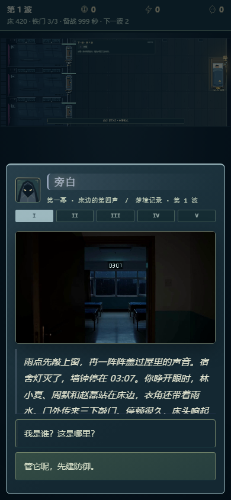

# 五幕剧情呈现与媒体复查

2026-11-08本地验收。本页记录画面、布局和媒体状态；完整截图目录包含第五幕内容，不把自动验收当作真人剧情体验或扬声器听感。

## 五幕的呈现

主线对话现在从 `STORY_ARCS` 获取所属幕，不依赖当前战斗波次猜测。缺少单独幕标题的主线节点也会显示正确标题；普通支线／Boss对话不会误借主线章节。

| 幕 | 波次 | 画面底色与灯光 | 当前配乐映射 |
|---|---|---|---|
| 床边的第四声 | 1—10 | 冷蓝灰、低饱和雨光 | 防线 |
| 倒放的值夜表 | 11—20 | 灰绿、旧记录与夜灯 | Memory Corridor |
| 空位属于谁 | 21—35 | 紫灰、镜面和冷影 | 余温回廊 |
| 灯一直亮着 | 36—50 | 暖黄铜、暗金灯光 | 余灯留暖 |
| 听完那条语音 | 51—60 | 低饱和浅绿、暖光收束 | 51—54影之摇篮曲，55—59余温回廊，60终局战 |

五段进度条只显示罗马序号及当前位置，不暴露后续幕标题。说话人的头像／颜色继续保留；切出剧情清除章节状态、恢复原暂停归属及音乐duck，玩家音量不被改写。

短屏／大字布局让文字区独立滚动，回应按钮不再被挤到卡片外。点击正在打出的文字时，完整内容从段首显示；逐字播放仍会随新文字滚动。手机章节元信息至少11px，大字13px，回应按钮至少48px。

## 实际运行证据

`npm run test:narrative`包含原防剧透流程及 `story-acts.browser.test.js`。后者在1440×900桌面、390×844手机、320×568大字三种视口，逐幕打开真实节点1／13／32／48／55，得到15组实际呈现：

- MP4实际解码至可显示状态，并定位到真实视频帧；MP3实际加载且播放时钟推进。
- 检查当前幕、未来标题隐藏、文字对比度、横向溢出、元信息字号及回应按钮完整可见。
- 打开／点击显示全文不领取奖励或承认已读真相；关闭后暂停归属、duck和37%玩家音乐音量保持正确。
- 支线对话不显示主线章节条；原有剧情选择、失败媒体和读档防重另由既有回归覆盖。

本次画面文字相对最亮底色的实测对比度均至少7:1；这仅覆盖这组正文与底色，不代表全站无障碍认证。原始截图与 `validation.json` 在 `artifacts/story-acts/`，均标为非物理设备。

## 原始媒体与钟面修正

逐一检查12段MP4和8首MP3。视频均为864×480、H.264、24fps、12.25秒；文件含AAC音轨，实际剧情播放器保持静音，由独立音乐与音效分组提供声音。8首MP3均可解析，44.1kHz双声道，时长约50.4—90秒。

开场与“缺失的七分钟”原镜头中的数字钟出现03:03／03:02等变化，与主线停在03:07不符。本轮跟踪并修正两段镜头中可读的钟面数字，没有裁掉镜头或替换整段画面：

- 两段各保留294帧、24fps、12.25秒，校正164帧中的可读数字；实际解码帧数、H.264 High／YUV420格式、原有色彩标记均与原片核对一致。
- 音轨重新封装前后逐字节一致。原文件备份、跟踪位置与校验记录保存在本地 `artifacts/story-acts/clock-correction/`。
- 以画面下半部作为未改动区域检查重新编码：PSNR均值约47.78dB。该数值只描述该区域的重编码误差，不是整幅主观质量评分。
- 两段校正后的文件SHA-256均为 `4321b8bb4c67912dcb5aa7153f979e91201cee9302695096acd0fb442bae3884`；文件名与原来的剧情挂接路径保持不变。

## 仍需实际体验

上述验证证明媒体可加载、画面信息与布局边界得到处理。五幕完整情绪、实际外放／耳机辨识、Android／iPhone解锁、地址栏／全屏／系统行为仍需物理设备记录。验收页已加入16项逐段试听，见 [DEVICE_TESTING.md](DEVICE_TESTING.md)。
