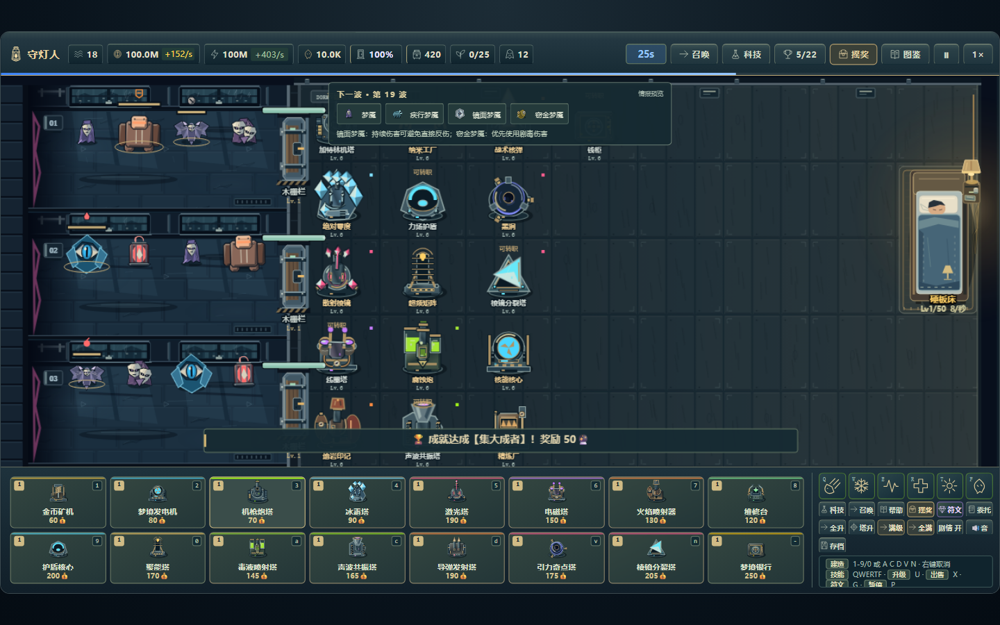

# UI 第二轮材质与头像精修

本轮在原雨夜蓝灰/黄铜/档案方向上继续细化，修改仅限 `theme.css`、`ui-art.js`，保留之前新增的 DPS 说明条和大字设置。手机原生尺寸操作层由独立模块负责，这里的样式不替代其布局。

## 已修改

- 首页面板加入静态细纹和上下受光边，设置/档案卡片分清亮面与暗面；主按钮采用黄铜顶边、压边和按下状态。没有新增持续光效、动态渐变、模糊或滤镜。
- HUD 用金属面板与底部黄铜边分组，资源数值采用等宽数字；床/门资源有更明确的分隔边，技能与建造卡片的键位、选中态和冷却数值更容易辨认。
- 科技、成就、存档、背包、日记与符文/奖励卡片加入档案内边、层级分隔和更清楚的小字；符文与抽取结果的品质标签保留原稀有色，并增加明确边框，碎片稀有度还影响上边缘材质。
- 对话头像从简笔面部升级为带侧光、发型、眼鼻、衣领、衣料分面和胸针的原创 SVG。林小夏为暖色短发/黄褐外套，周默为眼镜/蓝灰外套，赵磊为短发/绿色外套，玩家为蓝色外套；未知说话者仍使用兜帽，避免新增剧情身份提示。
- 灯具 Logo 改为带挂环、灯框、玻璃支撑与内焰的细线结构。新增 phone、rotate、fullscreen、menu、build、hand、close、pause、play、settings 图标，供手机操作层复用。
- SVG 图标与人物头像字符串增加按符号/身份缓存。未知人物共用单一匿名缓存，不随任意名字增长。既有 `UiArt.stats().thumbnails` 字段保留，另外提供 glyphs/portraits 数量。
- 新增辅助文字继续支持大字显示；保留原按钮和输入焦点轮廓，没有改动按钮 ID、事件或玩法属性。

## 验证边界

`node --check ui-art.js` 通过；SVG 字符串的 XML 与缓存复用独立检查由本轮记录。游戏级样板应在主代理统一构建后检查主页、完整 HUD、科技、符文/背包、林小夏剧情、未知说话者、大字与焦点状态，并同时验证手机操作层。

全部图形为原创代码内 SVG/CSS，无新增外部字体、图片请求或随机源。许可与资源清单由主代理统一调整为项目本轮指定协议。

## 主代理整合验收

已统一构建两份单文件并完成原生联系表及游戏截图检查。npm run test:polish; npm run test:browser; npm run test:mobile 已通过；另有2608项逻辑、许可/构建和手机专项通过。新增美术保持原数值、碰撞与缓存预算；文件仍仅在本地，未提交上传。

