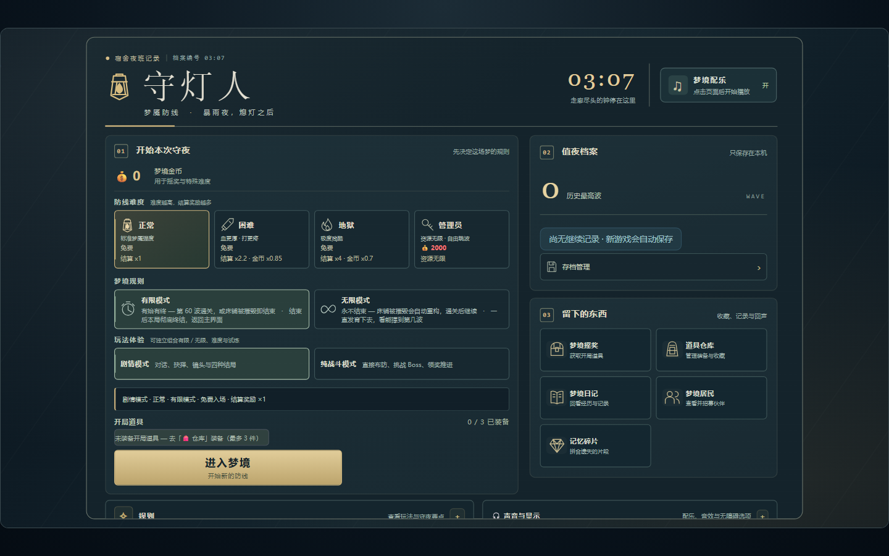
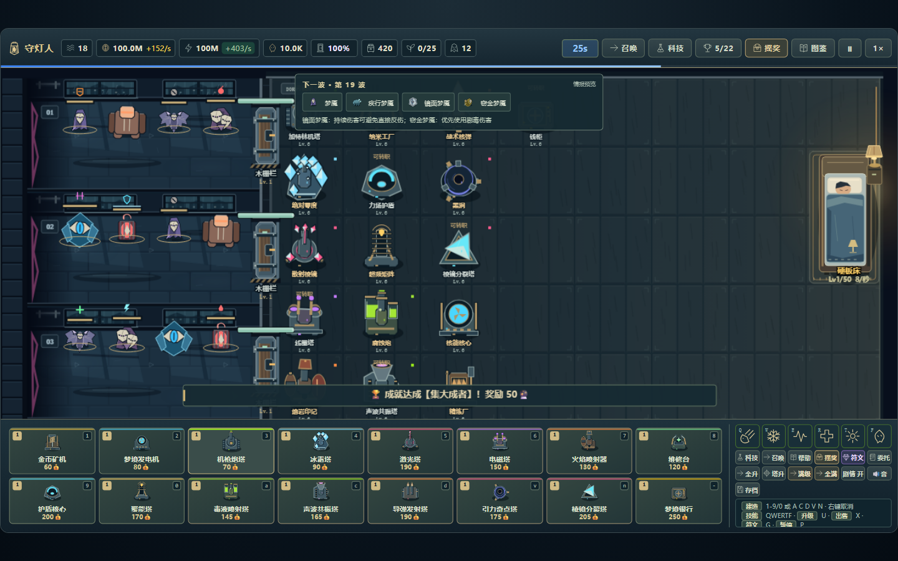
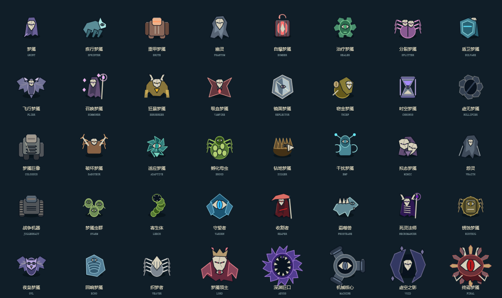
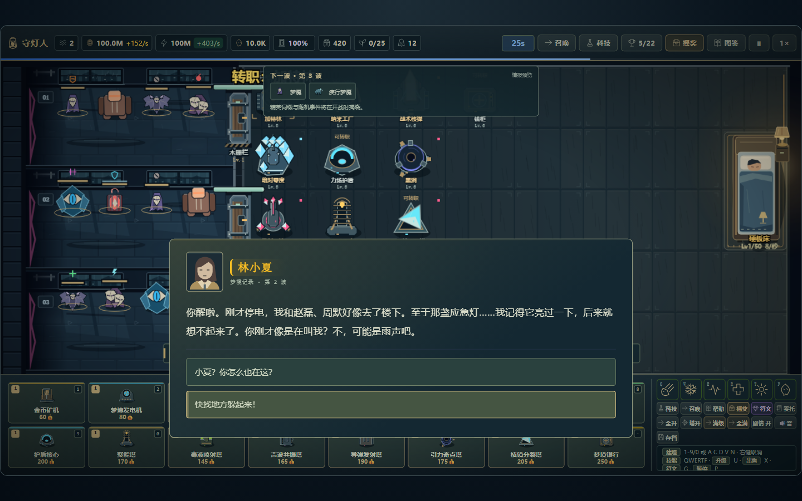
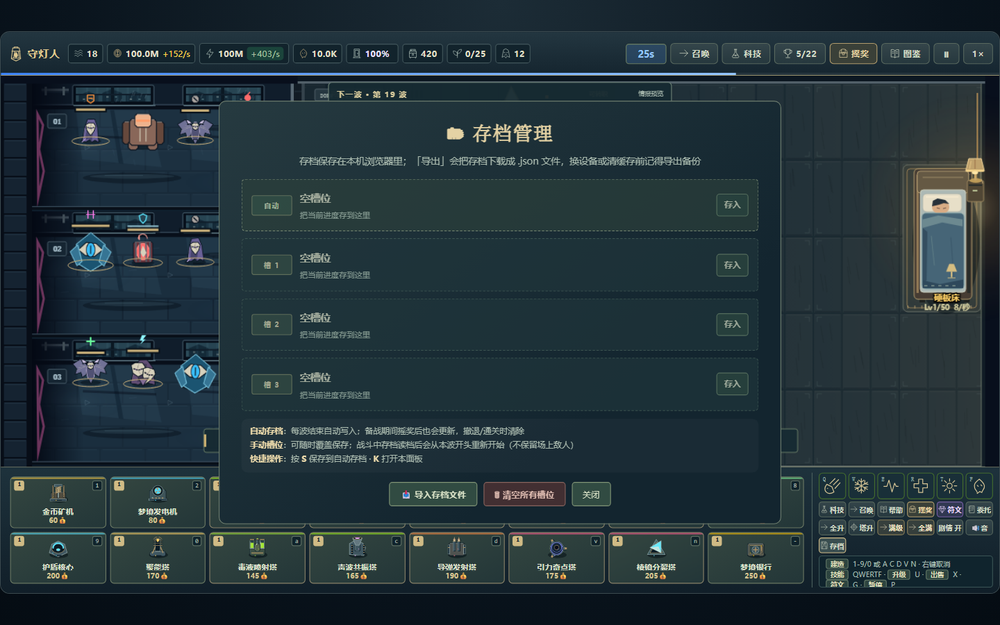
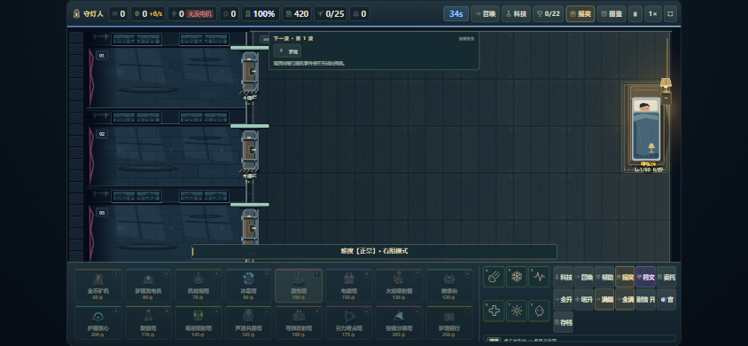
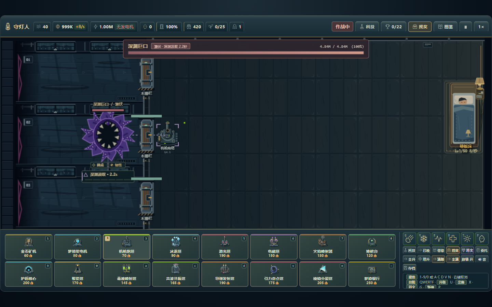

# 雨夜守灯：怪物与界面整合

本轮按用户“继续美化一切可以美化的地方”的委托自行选定样板：蓝灰石材、暖金黄铜、档案纸与低饱和危险色。沿用已有雨夜宿舍和机械建筑，不改变格子、实体坐标、碰撞半径与费用。当前文件版本为2.0.0（待发布）。

## 实际接入

- 35 普通梦魇、五 Boss 使用原创轮廓。兜帽、盾甲、蛛足、镜面、沙漏、机械履带、齿轮蟹、镰刀、触手和巨眼区分身份，不再依赖圆球加 Emoji。Boss 根据现有真实阶段显示不同结构；这不是五个新机制的完成声明。
- 移动、受击、控制、潜行、护盾和实际死亡后的短暂残影读取现有实体状态。10 类精英词缀有独立线形标记，燃烧/毒素/易伤仍有状态符号。死亡残影最多40个、0.4秒，在切换游戏对象时清除；美术观察器不写模拟实体、不耗战斗随机数。
- 主页、Logo、设置、HUD、科技、成就、符文、委托、存档、摇奖、背包、居民、日记、碎片、试炼、结局、教程、剧情与结算使用统一颜色、描边、排版和焦点样式。部分资源文字仍保留 Emoji。
- 建造栏16张缩略图及转职预览来自真实 BuildingArt；怪物图鉴和预告来自真实 EnemyArt。剧情加入原创 SVG 人物头像，萤火虫、梦境精灵和影子猫改用缓存矢量形象。单文件内运行，无新增网络图片或字体请求。
- 主菜单开始按钮进入首屏；详情动作固定于底部；转职改为原生按钮，支持键盘回车；存档等关闭按钮统一尺寸；结算返回动作保持可见。点击剧情正文可直接显示全文与选项。
- 修复科技/摇奖/成就面板首帧数据延迟刷新，以及成就图标被定时 HUD 更新覆盖回 Emoji 的问题。
- 波次开始使用紧凑黄铜告示牌，移除全场扫描与巨大缩放字；底部操作提示采用一致材质，降低动态时建造范围线静止。

## 截图样板

全部由实际游戏和真实 Chromium Canvas 直接截图，无后期拼贴。联系表使用相同运行时渲染器。

## 预算与验证

普通主体112²、Boss主体160²，各有命中遮罩。LRU同时限制64条和8,000,000字节像素数据；全图鉴及阶段样本52条、6,993,920字节，热缓存30帧零重建。主体和命中白片只烘焙一次；死亡仅复用主体。精英标记、生命条、控制状态和预警在主体后绘制。

`npm run test:art` 在真实 Canvas 检查场景、48建筑外观、40怪物的轮廓/裁切、五Boss全部现有阶段、移动/受击/降低动态、缓存、死亡观察及跨局清理。将 Math.random 改为抛错函数后，完整绘制仍不改变战斗字段。此前2295项逻辑断言和独立构建检查继续通过。

`npm run test:polish` 逐屏打开主要抽屉与档案，验证图标与真实缩略图、科技首帧数据、原生转职键盘操作、剧情点击全文、首屏开始及结算返回动作。三个关键小字选择器相对声明的不透明底色对比为6.61—9.40；这仅覆盖指定文字，不代表全站无障碍认证。桌面1440×900和触控844×390输出完整原始截图。`npm run test:browser` 另覆盖桌面/Android/WebKit的真实交互、布局、视频失败与后台恢复。

固定实体的前后对照见 [性能记录](PERFORMANCE.md)：32建筑+95敌人，前后各两次独立测量，平均帧间隔约22.80→16.67ms，JS绘制2.29→1.71ms。软件栅格、暂停场景，不等同实战或物理手机性能。

方法参考：[MDN Canvas优化](https://developer.mozilla.org/en-US/docs/Web/API/Canvas_API/Tutorial/Optimizing_canvas)的重复图形离屏复用建议；[Xbox文字指南](https://learn.microsoft.com/en-us/gaming/accessibility/xbox-accessibility-guidelines/101)与[对比度指南](https://learn.microsoft.com/en-us/gaming/accessibility/xbox-accessibility-guidelines/102)用于检查文字与焦点可读性。资源来源和尺寸登记于 [enemies.json](../assets/art/enemies.json)、[ui.json](../assets/art/ui.json)，全部原创程序化 Canvas/SVG，按仓库 Apache-2.0 许可（历史声明保留在 LICENSES/MIT-legacy.txt）。

2026-11-08续作已加入画质分级、五Boss机制、音频分组、实际DPS、全来源剧情防剧透，以及分支／词缀客观对照；当前3694项逻辑断言另有构建、许可及浏览器专项。详见 [V2_STATUS.md](V2_STATUS.md)。真实Android／iPhone、安全区／全屏／系统行为、实际听感与人工难度评价仍待独立验收，美化不等同全部发布条件完成。

2026-11-08继续完善五幕剧情的章节条、灯光底色与短屏大字阅读，回应按钮在320px大字模式完整可见。开场与回忆的可读钟面统一为03:07，保留原运镜、完整帧数与音轨。桌面／手机共15组实际媒体检查和首幕安全示例见 [剧情呈现复查](STORY_PRESENTATION_REVIEW.md)。
