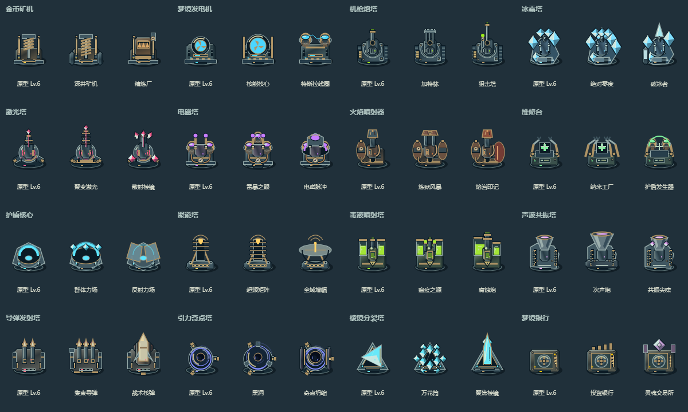

# 武器材质与机械细节再打磨

延续蓝灰金属、黄铜接头、暖金灯光与小面积属性色的雨夜方向。本轮在现有16建筑、32转职的主体结构上加强材质，不改变格子、锚点、碰撞、射程、伤害、费用或模拟状态。

## 已修改的美术

- 金属板增加冷暖亮暗面、硬边倒角、底部暗边和嵌入式螺栓；底座补充低矮承重盘，提升和湿石砖背景之间的轮廓分离。
- 炮管有沿轴高光、黄铜制退器和深色内膛；加特林明确显示三管端口，狙击塔补充支撑轨与瞄准镜反光。
- 冰晶与棱镜增加明暗折面，冰塔补充冷却装甲、导管和散热槽；激光塔增加聚能底座、双侧电容与导轨细节。
- 电磁装置增加铜绕组、深色绝缘柱、陶瓷接头和读数表；发电机增加散热片、旋转核心护圈与工作条。
- 火焰塔增加燃料管、压力表和喷口金属翻边；毒塔增加玻璃液面、气泡、观察窗和危险铭牌。
- 声波塔增加音箱栅格、号角内外层及滚边；导弹舱增加装甲铰链、发射筒口、尾段箍带和状态条。
- 引力塔增加约束环刻度与夹具；维修台补充机械臂轴承及工具屏，护盾塔补充发射支座，聚能塔补充接线端子，银行补充多层轮锁和金库面板。

## 技术边界与验证

新增拉丝金属渐变只在离屏底盘/武器头首次烘焙时创建；转向、后坐、工作和待机继续复用原有80²/96²组件，不增加常驻模糊或每帧阴影。色阶小缓存最多64条，主体缓存继续最多144个组件。

使用独立的真实Chromium Canvas源文件样板检查（不写生成HTML）：48外观保持全部不同，128²采样有可见主体且无边缘裁切；令Math.random抛错仍能完成绘制；全部48外观旋转30帧新增组件构建为0、渐变创建为0。该单等级样板缓存78条、2,334,720字节，前后相同。样板输出在忽略目录artifacts/weapons-before.png、weapons-after.png；本轮代理已查看原生联系表。

`tests/building-art.test.js`补充热缓存中48外观旋转30帧零渐变创建的检查。完整游戏仍由主代理统一构建，执行48外观、等级/动画状态和实战绘制隔离回归，并在新手机界面中检查缩小后的识别效果。新细节仍是原创程序化Canvas；许可登记由主代理统一更新为项目本轮协议。

## 主代理整合验收

已统一构建两份单文件并完成原生联系表及游戏截图检查。node tests/building-art.test.js 已通过；另有2608项逻辑、许可/构建和手机专项通过。新增美术保持原数值、碰撞与缓存预算；文件仍仅在本地，未提交上传。

